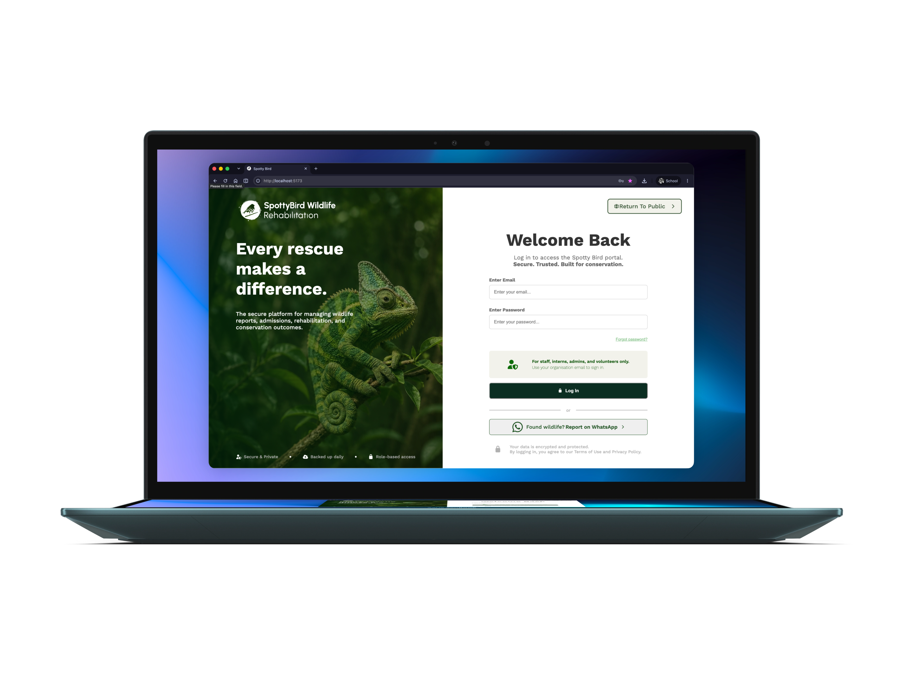
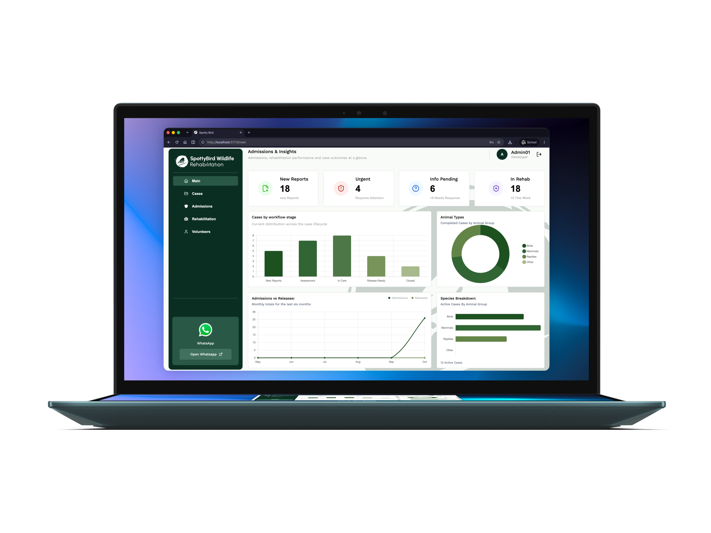
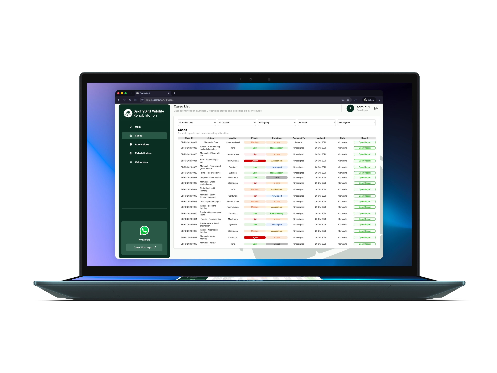
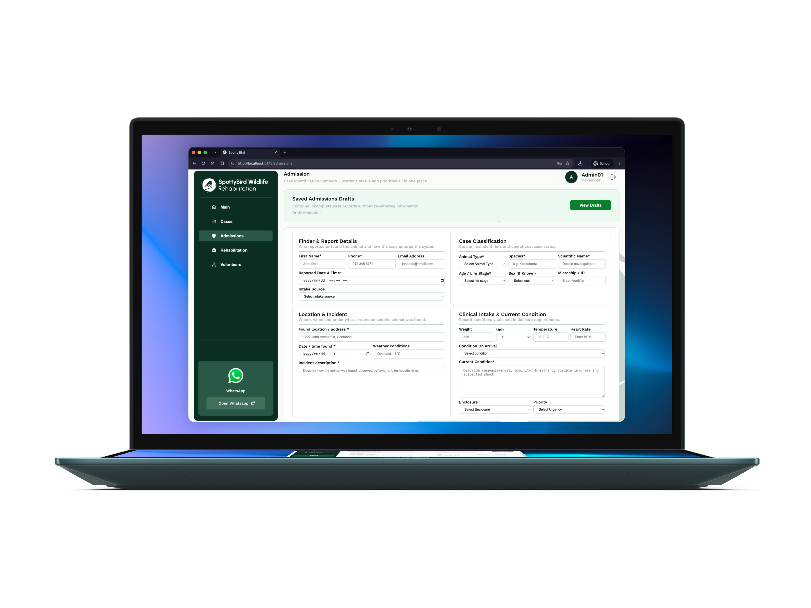
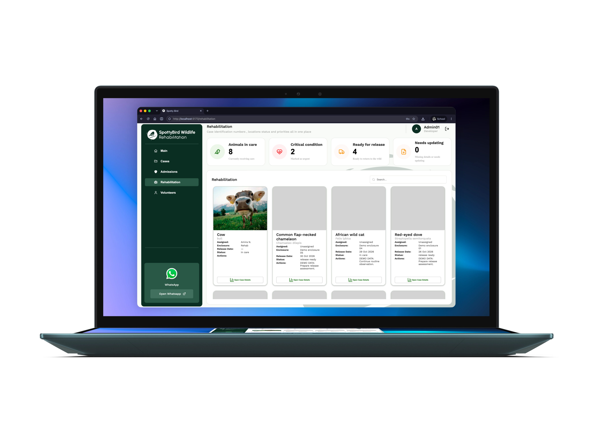
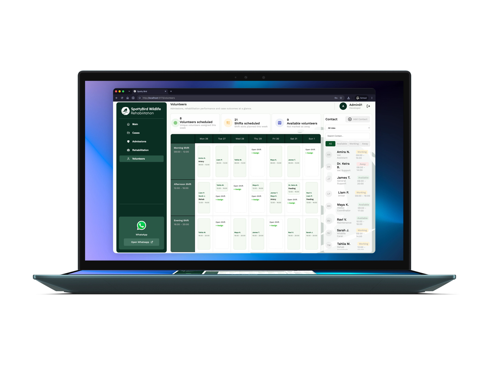
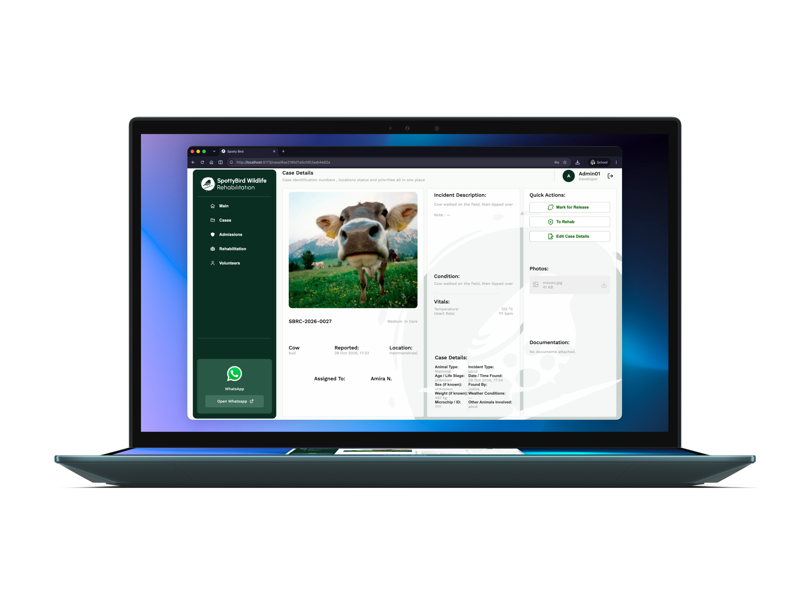

<!-- REPLACE ALL THE [USERNAME] TEXT WITH YOUR GITHUB PROFILE NAME & THE [PROJECTNAME] WITH THE NAME OF YOUR GITHUB PROJECT -->

<!-- Repository Information & Links-->
<!-- HEADER SECTION -->
<h5 align="center" style="padding:0;margin:0;">Robert van Eijk</h5>
<h5 align="center" style="padding:0;margin:0;">251185</h5>
<h6 align="center">DV200 2026</h6>
</br>
<p align="center">

  <a href="https://github.com/RobertvanEijk-OW-251185/DV200_Theme_4_SpottyBird">
    
  </a>
  
  <h3 align="center">SpottyBird Wildlife</h3>

  <p align="center">
    Short Project Slogan / Description <br>
      <a href="https://github.com/username/projectname"><strong>Explore the docs »</strong></a>
   <br />
   <br />
   <a href="path/to/demonstration/video">View Demo</a>
    ·
    <a href="https://github.com/username/projectname/issues">Report Bug</a>
    ·
    <a href="https://github.com/username/projectname/issues">Request Feature</a>
</p>

<!--PROJECT DESCRIPTION-->

## About the Project

<!-- header image of project -->

### Project Description

A nice introduction to this amazing project of mine.

### Built With

- [MongoDB]([path/to/technology/website](https://www.mongodb.com/lp/cloud/atlas/try4-reg?utm_source=google&utm_campaign=search_gs_pl_evergreen_mongodb_general_prosp-brand_gic-null_emea-multi_ps-all_desktop_eng_lead&utm_term=mongo%20database&utm_medium=cpc_paid_search&utm_ad=e&utm_ad_campaign_id=23930728972&adgroup=197004289829&cq_cmp=23930728972&gad_source=1&gad_campaignid=23930728972&gbraid=0AAAAADQ1400ViKfN-IryK96sCyKXrTm55&gclid=CjwKCAjwuobXBhBXEiwAYUaIlWOSRExJa29xp56vkX0yrcoATIYnepT9WMXhUyztlnaJjtpgC55ahBoCiXQQAvD_BwE))
- [Express.Js]([path/to/technology/website](https://expressjs.com/))
- [React Vite]([path/to/technology/website](https://vite.dev/guide/))
- [Node.Js]([path/to/technology/website](https://nodejs.org/en))

<!-- GETTING STARTED -->
<!-- Make sure to add appropriate information about what prerequesite technologies the user would need and also the steps to install your project on their own mashines -->

## Getting Started

The following instructions will get you a copy of the project up and running on your local machine for development and testing purposes.

### Prerequisites

Ensure that you have the latest version of [Software](path/to/where/they/can/download/software) installed on your machine. The [Plugin](path/to/where/they/can/download/plugin) plugin will also be required.

### How to install

### Installation

Here are a couple of ways to clone this repo:

1.  Software </br>
    `Android Studio` -> `File` -> `New` -> `From Version Control` -> `Git`</br>
    Enter `https://github.com/username/projectname.git` into the URL field and press the `Clone` button.

2.  Clone Repository </br>
    Run the following in the command-line to clone the project:

    ```sh
    git clone https://github.com/username/projectname.git
    ```

        Open `Software` and select `File | Open...` from the menu. Select cloned directory and press `Open` button

3.  Install Dependencies </br>
    Run the following in the command-line to install all the required dependencies:

    ```sh
    npm install
    ```

4.  Get a free API Key at [https://example.com](https://example.com) and enter it in the `config.js` file:
    ```js
    const API_KEY = "ENTER YOUR API";
    ```

<!-- FEATURES AND FUNCTIONALITY-->
<!-- You can add the links to all of your imagery at the bottom of the file as references -->

## Features and Functionality



### Feature 1

Description of Feature



### Feature 2

Description of Feature



### Feature 3

Description of Feature



### Feature 4

Description of Feature



### Feature 5

Description of Feature



### Feature 6

Description of Feature



<!-- DEVELOPMENT PROCESS -->

## Development Process

The `Development Process` is the technical implementations and functionality done in the frontend and backend of the application.

### Implementation Process

<!-- stipulate all of the functionality you included in the project -->

- Made use of both `functionality` to implement a specific feature.
- `MVC/MVVM` design architecture implemented.
- `Plugin` for this.
- ETC.

#### Highlights

<!-- stipulated the highlight you experienced with the project -->

- Sunshine.
- Rainbows.

#### Challenges

<!-- stipulated the challenges you faced with the project and why you think you faced it or how you think you'll solve it (if not solved) -->

- Bugs.
- Bugs.

### Future Implementation

<!-- stipulate functionality and improvements that can be implemented in the future. -->

- Future 1.
- Future 2.

<!-- VIDEO DEMONSTRATION -->

### Video Demonstration

To see a run through of the application, click below:

[View Demonstration](path/to/video/demonstration)

<!-- AUTHORS -->

## Authors

- **Robert van Eijk** - [RobertvanEijk-OW-251185](https://github.com/RobertvanEijk-OW-251185)

<!-- LICENSE -->

## License

Distributed under the MIT License. See `LICENSE` for more information.\

<!-- ACKNOWLEDGEMENTS -->

## Acknowledgements

<!-- all resources that you used and Acknowledgements here -->

- [Resource Name](path/to/resource)
- [Resource Name](path/to/resource)
- [Resource Name](path/to/resource)
- [Resource Name](path/to/resource)
- [Resource Name](path/to/resource)


